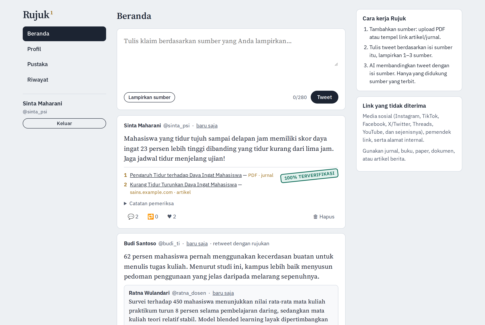
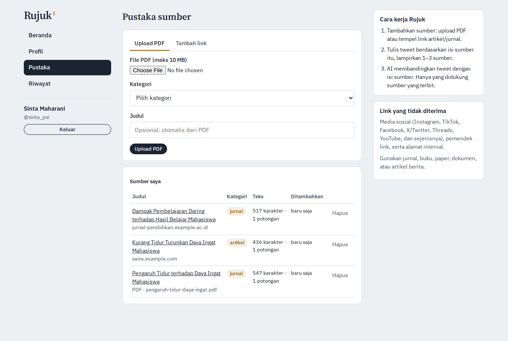
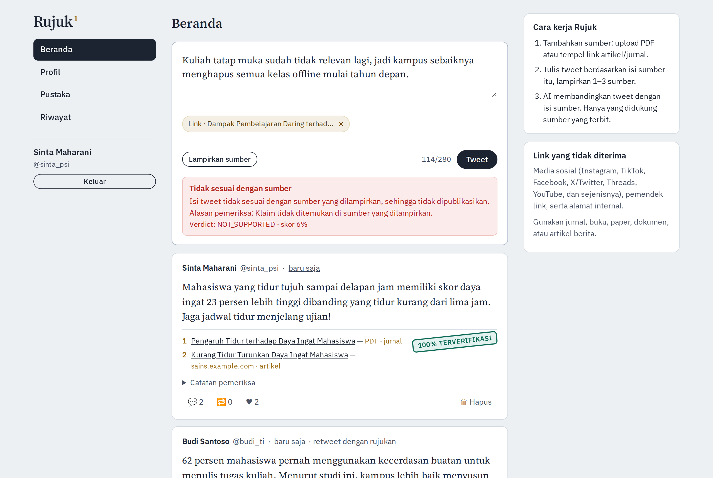
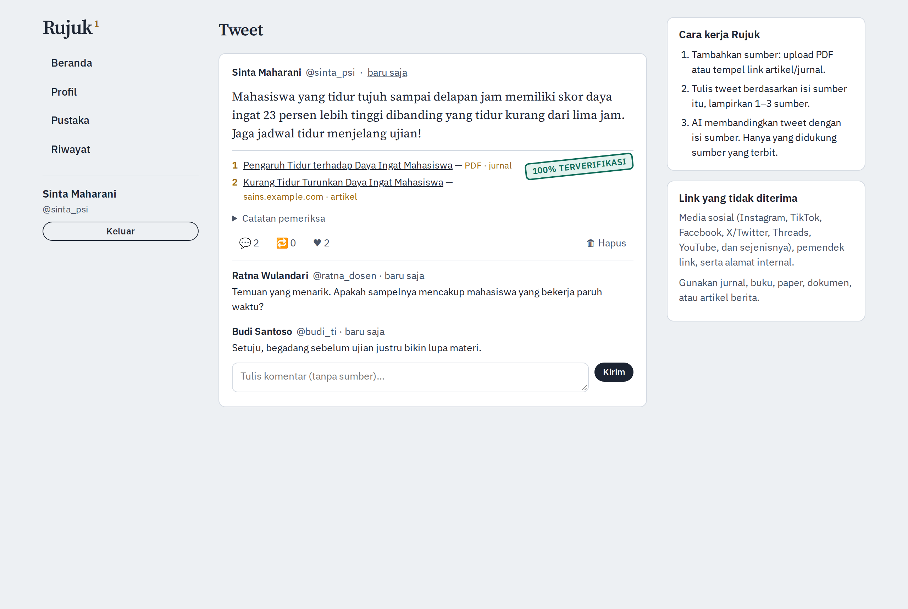
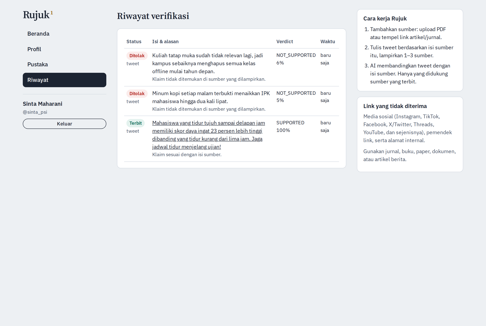
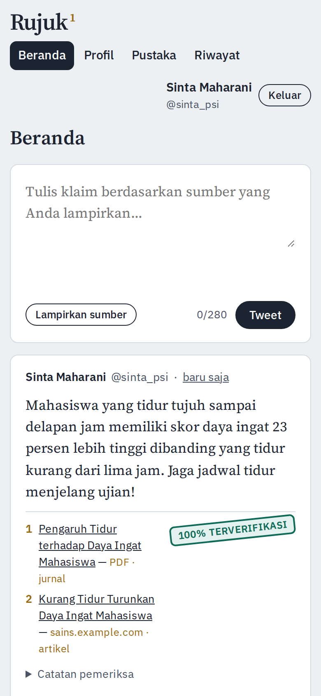

# Rujuk

**Debat ilmiah yang wajib bersumber.** Rujuk adalah mikroblog (mirip Twitter) untuk mahasiswa, dosen, dan siapa saja
yang senang berdiskusi soal ilmu, dengan satu aturan: **setiap tweet dan retweet harus melampirkan rujukan**
(PDF jurnal, buku, paper, dokumen, atau link artikel/berita), dan isinya **diperiksa AI** sebelum terbit.

Klaim yang tidak didukung sumbernya ditolak, beserta alasannya. Tidak ada lagi "katanya", yang ada "menurut halaman sekian".

[](#pengujian)
[](https://nodejs.org)
[](LICENSE)



---

## Tampilan & cara pakai

Alur dasarnya cuma tiga langkah: **tambah sumber → tulis klaim → AI memeriksa**.

### 1. Tambahkan sumber ke pustaka
Buka menu **Pustaka**, lalu unggah PDF (jurnal, buku, paper, dokumen) atau tempel link artikel/jurnal online.
Pilih kategorinya; judul diambil otomatis dari metadata PDF atau judul halaman. Teks sumber langsung dibaca dan diindeks.



### 2. Tulis klaim dan lampirkan sumber
Di **Beranda**, tulis tweet (maks 280 karakter), klik **Lampirkan sumber**, lalu pilih 1–3 sumber dari pustaka Anda.
Jika klaim **tidak didukung** sumber yang dilampirkan, tweet ditolak dan Anda melihat alasan dari pemeriksa beserta skornya.
Perbaiki klaimnya, atau lampirkan sumber yang tepat.



### 3. Diskusi: like, komentar, dan retweet dengan rujukan
Tweet yang terbit menampilkan daftar sumber bergaya catatan kaki dan cap **TERVERIFIKASI**. Pembaca bisa membuka sumbernya,
memberi like, dan berkomentar (komentar tidak wajib sumber). Mau membantah atau menambahkan? Gunakan **retweet dengan rujukan**:
tanggapan Anda juga wajib bersumber dan ikut diverifikasi.



### 4. Lihat riwayat verifikasi
Menu **Riwayat** mencatat semua percobaan tweet Anda, baik yang terbit maupun yang ditolak, lengkap dengan verdict, skor, dan alasan.
Berguna untuk belajar menulis klaim yang presisi sesuai sumber.



<details>
<summary><strong>Tampilan di ponsel</strong></summary>



</details>

> Screenshot di atas memakai data contoh (pengguna, artikel, dan domain `example.*` fiktif) untuk keperluan dokumentasi.

## Fitur

- **Tweet & quote-retweet wajib bersumber**: lampirkan 1–3 sumber milik sendiri (PDF, link, atau keduanya).
- **Verifikasi RAG dengan OpenAI**: isi tweet dibandingkan dengan potongan teks sumber yang paling relevan.
  Hanya terbit jika verdict `SUPPORTED` dan skor ≥ ambang (default 0,7). Jika tidak, ditolak dengan HTTP 422 + alasan.
- **Link media sosial ditolak**: Instagram, TikTok, Facebook, X/Twitter, Threads, YouTube, Reddit, pemendek link, dll.
  Rujukan harus berupa sumber ilmiah, berita, atau dokumen.
- **Pustaka sumber pribadi**: unggah PDF (maks 10 MB) atau tambahkan link, dengan kategori `jurnal`, `buku`, `paper`, `dokumen`, `artikel`.
- **Cap "terverifikasi"** pada setiap tweet, lengkap dengan skor, catatan pemeriksa, dan daftar sumber bergaya catatan kaki.
- **Riwayat verifikasi**: semua percobaan (terbit maupun ditolak) bisa dilihat kembali.
- **Like & komentar**: komentar tidak wajib sumber dan tidak diverifikasi AI.
- **Profil**: nama tampilan, bio, jumlah tweet/retweet/sumber.

## Cara kerja verifikasi

```
Tambah sumber ─► ekstrak teks (unpdf / cheerio) ─► potong per ±1000 karakter ─► embedding OpenAI ─► simpan di SQLite

Kirim tweet  ─► embedding klaim ─► ambil 6 potongan paling mirip (cosine) ─► OpenAI chat (JSON) menilai
             ─► SUPPORTED & skor ≥ 0,7 ? terbit (201) : ditolak (422 + alasan)
```

Model hanya boleh menilai berdasarkan kutipan sumber, dan teks sumber/klaim diperlakukan sebagai data (bukan instruksi)
untuk mengurangi prompt injection. Balasan AI divalidasi strukturnya; jika tidak valid, tweet tidak disimpan (502).

> **Hanya OpenAI API.** Pipeline RAG Rujuk dibuat dan diuji untuk OpenAI API resmi
> (`gpt-4o-mini` + `text-embedding-3-small` secara default). Provider lain/endpoint kompatibel tidak didukung:
> server akan menolak start jika `OPENAI_BASE_URL` diisi di luar mode tes.
> Tanpa `OPENAI_API_KEY`, endpoint sumber & tweet membalas `503 AI_NOT_CONFIGURED` (tidak ada mode "pura-pura lolos").

## Tech stack

| Bagian | Teknologi |
|---|---|
| Backend | Node.js ≥ 22, Express 4 |
| Database | SQLite (`better-sqlite3`), mode WAL |
| AI / RAG | `openai` (embeddings + chat completions) |
| Ekstraksi sumber | `unpdf` (PDF), `cheerio` (HTML) |
| Auth | `bcryptjs`, JWT di cookie httpOnly `SameSite=Strict` |
| Keamanan | `helmet` (CSP ketat), `express-rate-limit`, validasi whitelist |
| Frontend | HTML + CSS + JavaScript vanilla (SPA hash-router), tanpa build step |
| Tes | `node:test` + `fetch` bawaan Node |

## Mulai cepat

### Prasyarat
- Node.js **22 atau lebih baru**
- API key OpenAI ([platform.openai.com/api-keys](https://platform.openai.com/api-keys))

### Menjalankan secara lokal
```bash
git clone https://github.com/<username-anda>/rujuk.git
cd rujuk
npm install

cp .env.example .env
# isi OPENAI_API_KEY, lalu buat JWT_SECRET acak:
node -e "console.log(require('crypto').randomBytes(48).toString('hex'))"

npm run dev        # http://localhost:3000 (auto-reload)
# atau
npm start
```

Cek: `curl http://localhost:3000/api/health` → `{"ok":true,"ai_configured":true}`

### Menjalankan dengan Docker
```bash
cp .env.example .env          # isi OPENAI_API_KEY dan JWT_SECRET (wajib ≥ 32 karakter)
docker compose up -d --build  # http://localhost:3000
docker compose logs -f app
docker compose down           # data tetap ada di volume
docker compose down -v        # hapus juga DB & PDF (data hilang!)
```

Catatan:
- Image `node:22-bookworm-slim`, berjalan sebagai user non-root, filesystem read-only, `cap_drop: ALL`, `no-new-privileges`.
- DB disimpan di named volume `rujuk-data`, PDF di `rujuk-uploads`. Di Windows/WSL, **jangan** bind-mount DB ke `/mnt/c/...`
  (locking SQLite bisa rusak).
- Di production cookie sesi ber-flag `Secure`: buka lewat `http://localhost:3000` atau pasang HTTPS (reverse proxy).
  Akses lewat IP LAN tanpa HTTPS membuat login tidak tersimpan.
- Container berhenti saat start jika `JWT_SECRET` kosong/kurang dari 32 karakter (disengaja).

## Konfigurasi

Semua lewat `.env` (lihat [`.env.example`](.env.example)). Nilai kosong memakai default.

| Variabel | Default | Keterangan |
|---|---|---|
| `OPENAI_API_KEY` | – | **Wajib.** API key OpenAI |
| `OPENAI_CHAT_MODEL` | `gpt-4o-mini` | Model penilai (harus mendukung `response_format: json_object`) |
| `OPENAI_EMBED_MODEL` | `text-embedding-3-small` | Model embedding |
| `VERIFY_MIN_SCORE` | `0.7` | Skor minimal agar tweet terbit (0–1) |
| `JWT_SECRET` | acak per start (dev) | Wajib ≥ 32 karakter di production |
| `PORT` | `3000` | |
| `NODE_ENV` | `development` | `development` / `production` |
| `MAX_PDF_MB` | `10` | Ukuran maksimal unggahan PDF |
| `MAX_FETCH_MB` | `5` | Ukuran maksimal unduhan link |
| `FETCH_TIMEOUT_MS` | `15000` | Batas waktu mengambil link |
| `MIN_SOURCE_TEXT_CHARS` | `200` | Sumber dengan teks lebih sedikit ditolak (mis. PDF hasil scan) |
| `MAX_CHUNKS_PER_SOURCE` | `150` | Batas biaya embedding per sumber |
| `DB_PATH` | `./data/rujuk.db` | Lokasi database SQLite |
| `UPLOAD_DIR` | `./uploads` | Lokasi file PDF |

**Perkiraan biaya**: setiap sumber di-embed sekali (maks 150 potongan), setiap tweet memakai 1 embedding + 1 panggilan chat.
Dengan model default, biayanya sangat kecil per tweet, tetapi tetap pantau penggunaan di dashboard OpenAI Anda.

## Struktur proyek

```
rujuk/
├── server/
│   ├── index.js              # entry point: listen + graceful shutdown
│   ├── app.js                # Express app: helmet/CSP, rate limit, cek Origin, routing, error handler terpusat
│   ├── config.js             # baca & validasi .env
│   ├── db.js                 # koneksi SQLite + skema
│   ├── errors.js             # AppError & helper
│   ├── validators.js         # semua validasi input (whitelist)
│   ├── middleware/auth.js    # JWT cookie
│   ├── routes/               # auth, sources, posts (tweet/retweet/like/komentar), users
│   └── services/
│       ├── rag.js            # chunking, embedding, retrieval, penilaian OpenAI, validasi output AI
│       └── sources.js        # ekstraksi PDF, pengambilan link anti-SSRF, blocklist media sosial
├── public/                   # frontend SPA (index.html, app.js, styles.css)
├── assets/screenshots/       # gambar untuk README
├── tests/
│   ├── error-cases.test.js   # 89 kasus input tidak valid untuk form registrasi, login, tweet, sumber, komentar
│   ├── features.test.js      # alur lengkap: daftar → sumber → tweet → like → komentar → retweet → hapus
│   ├── support/stubs.js      # stub OpenAI & web lokal (khusus tes)
│   └── fixtures/             # PDF valid, PDF tanpa teks, PDF rusak, bukan PDF, .docx
├── Dockerfile
├── docker-compose.yml
└── .env.example
```

## API ringkas

Base path `/api`. Error selalu berbentuk `{ "error": { "code", "message", "fields?" } }`.

| Method | Path | Keterangan |
|---|---|---|
| POST | `/auth/register`, `/auth/login`, `/auth/logout` | Registrasi, login (username/email), logout |
| GET | `/auth/me` | User yang sedang login |
| POST | `/sources/pdf` | Unggah PDF (multipart: `file`, `category`, `title?`) |
| POST | `/sources/link` | Tambah link `{url, category, title?}` |
| GET / DELETE | `/sources`, `/sources/:id` | Daftar / hapus sumber milik sendiri |
| GET | `/sources/:id/file` | Unduh PDF (pemilik, atau publik jika sudah dilampirkan di tweet) |
| GET | `/posts?cursor=&user=` | Feed (20 per halaman) |
| POST | `/posts` | Tweet/retweet `{content, source_ids, parent_id?}` → 201 atau 422 |
| GET / DELETE | `/posts/:id` | Detail / hapus tweet |
| POST / DELETE | `/posts/:id/like` | Like / unlike (idempoten) |
| GET / POST | `/posts/:id/comments` | Daftar / tulis komentar |
| DELETE | `/comments/:id` | Hapus komentar sendiri |
| GET | `/users/:username` | Profil publik |
| PATCH | `/me` | Ubah nama tampilan & bio |
| GET | `/me/verifications` | Riwayat verifikasi (50 terbaru) |
| GET | `/health` | Status server & AI |

## Keamanan

Dibangun dengan prinsip *defensive programming*:

- Semua input divalidasi di backend dengan whitelist, terpusat di `server/validators.js`.
- SQL hanya lewat prepared statement.
- Anti-XSS: teks pengguna dirender dengan `textContent`, CSP tanpa `unsafe-inline`.
- Anti-SSRF: blokir IP privat/localhost (dicek pada alamat yang benar-benar dipakai koneksi), cek ulang setiap redirect
  (maks 3), batas waktu & ukuran unduhan, hanya HTML/PDF/teks.
- File: cek ekstensi, MIME, **dan** magic bytes `%PDF-`; nama file di disk dibuat acak.
- Akun dikunci 15 menit setelah 5 kali gagal login; rate limit per IP untuk auth, sumber, dan posting.
- Error terpusat: stack trace tidak pernah dikirim ke klien. Output AI tidak dipercaya begitu saja.

Menemukan celah keamanan? Mohon laporkan secara privat lewat fitur
[Security Advisories](../../security/advisories/new) GitHub, jangan lewat issue publik.

## Pengujian

```bash
npm test
```

90 tes (89 kasus data error + 1 alur fitur lengkap) berjalan dengan **stub OpenAI lokal**, jadi tidak memakai kuota API
dan tidak butuh API key. Stub hanya ada di `tests/support/` dan hanya aktif saat `NODE_ENV=test`.

## Kontribusi

Kontribusi sangat diterima. Baca [CONTRIBUTING.md](CONTRIBUTING.md) sebelum membuka pull request.

## Lisensi

[MIT](LICENSE)
